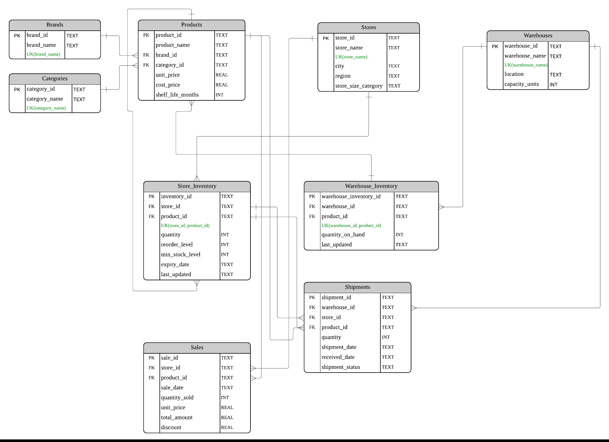

# PopBeauty: Retail Inventory Analytics (SQL, data modelling, Power BI)

[](https://github.com/anandjashwanth/popbeauty-inventory-analytics/actions/workflows/ci.yml)

**Diagnosing an inventory imbalance across a 13-store UK beauty retailer with a relational database, 26 SQL queries, a demand forecasting backtest and a Power BI dashboard.**

> This is an academic group project (Warwick Business School, MSc Business Analytics) built on **synthetic data** for a **fictional** retailer, "PopBeauty". It is shared as a portfolio piece, not as real company data.

## My contribution
This was a six-person team project. My role covered the core technical build and analysis: I designed and built the SQLite database, wrote the SQL queries behind the insights below, carried out the data analysis, wrote the report and co-presented the findings. The Power BI dashboards are my own build.

## The problem
PopBeauty's 13 stores were not receiving stock in proportion to demand. Smaller stores built up stock they could not sell, while high-footfall stores ran short. **The stock already existed inside the network**, so this was an allocation and process problem, not a supply shortage, and it caused stockouts and write-offs at the same time.

The question: *where is the money trapped, and why?*

## Data model
Nine tables in third normal form (3NF): Brands, Categories, Products, Stores, Warehouses, Store_Inventory, Warehouse_Inventory, Shipments and Sales.



The schema in [`sql/schema.sql`](sql/schema.sql) **enforces** the model rather than just describing it:
- primary keys on every table and foreign keys on every relationship;
- unique keys, for example one inventory row per store and product;
- value checks, for example no negative stock and discounts between 0 and 1;
- indexes on the most-joined columns.

[`src/build_db.py`](src/build_db.py) loads the raw synthetic data into this schema in dependency order and fails loudly if any row breaks a rule. All 4,843 rows pass.

## Key insights (all from SQL)
1. **Misplacement, not shortage.** The London Flagship converted **43%** of its stock into sales against **9 to 12%** at boutiques, while holding the *fewest* units.
2. **Premium products in the wrong stores.** Around 280 to 300 units of Dyson Airwrap and FOREO LUNA sat in boutiques selling 0 to 1 units, while the Flagship held 2 to 5 units at critical level. Beauty Tools carry the highest gross margin (59%), so this was a margin problem, not just a revenue one.
3. **Around £130K of expiry risk.** Query 17 estimates about £130K of short-life skincare at retail value (about £59K at cost) on course to expire unsold, the largest share in Coventry. Meanwhile some of the *same products* were critically short in Edinburgh and Glasgow.
4. **A 394-day "ghost shipment".** 25 shipments were stuck "In Transit", the oldest for 394 days from a warehouse 10 miles away. Because the system treated them as pending, it suppressed new orders and kept Manchester and Liverpool empty.
5. **One reorder rule for every store.** Identical reorder thresholds were applied to stores whose sales rates differ by 10 times, overstocking slow stores and starving fast ones.
6. **Discounting as a symptom.** Repeated 17 to 19% discounts at slow stores failed to clear stock; the same products sold at full price, in 6 to 7 times the volume, at the Flagship.

## Recommendation
**Much of this is recoverable with £0 extra spend**, using stock already in the network: redistribute premium tools and expiring skincare to where demand is, write off and replace the ghost shipments, stop ineffective discounting, and set reorder levels from each store's sales rate.

## Demand forecasting
[`src/forecast.py`](src/forecast.py) forecasts weekly units sold for each of the six categories. It compares four methods (naive, 4-week moving average, exponential smoothing and a 12-week linear trend) in a **rolling-origin backtest**: each of the last 12 weeks is forecast using only the weeks before it, so no future data leaks into the test.

| Category | Best method | Error (WAPE) | Improvement on naive |
|---|---|---|---|
| Makeup | Naive | 0.29 | 0% |
| Haircare | Exponential smoothing | 0.79 | 10% |
| Fragrance | Exponential smoothing | 1.04 | 11% |
| Beauty Tools | 4-week moving average | 0.90 | 31% |
| Beauty Accessories | 4-week moving average | 1.39 | 33% |
| Skincare | 4-week moving average | 0.80 | 38% |

**What this shows honestly:** smoothing beats the naive forecast in 5 of 6 categories, but weekly error stays high outside Makeup, because most categories sell only 4 to 20 units a week. At this volume, forecasts should be made monthly or pooled across stores before being used for replenishment. The tool also converts forecasts into weeks of stock cover; the results (hundreds of weeks) show the synthetic stock levels are far larger than sales, which is itself a data quality finding.

## Metric definitions
[`docs/metrics.md`](docs/metrics.md) defines every metric exactly as the SQL computes it, with edge cases and known limitations, for example that write-off value uses retail rather than cost price.

## Run it yourself
```bash
pip install -r requirements.txt -r requirements-dev.txt
python src/build_db.py                 # builds data/popbeauty.db with enforced keys and checks
python src/run_queries.py              # runs all 26 analysis queries and prints row counts
python src/run_queries.py --show 21    # shows one result, e.g. the stuck shipments
python src/forecast.py                 # demand forecast backtest and weeks of cover
pytest -q                              # data integrity and query tests
```

**Continuous integration:** on every push, GitHub Actions lints the code, rebuilds the database, runs all 26 queries, runs the forecast backtest and runs the tests. The tests check that every table loads, no foreign key is broken, bad data (an unknown store, a duplicate inventory row, negative stock) is rejected, every query returns results, and the headline finding still holds.

## Repository contents
| Path | What it is |
|---|---|
| `sql/schema.sql` | Database schema with primary, foreign and unique keys and value checks |
| `sql/analysis_queries.sql` | All 26 analysis queries, numbered and labelled by question |
| `src/build_db.py` | Builds the database from the raw synthetic data and checks integrity |
| `src/run_queries.py` | Runs every query, or shows one result |
| `src/forecast.py` | Weekly demand forecasting with a rolling backtest |
| `docs/metrics.md` | Exact metric definitions and known limitations |
| `tests/` | Data integrity, query and forecasting tests (11) |
| `notebooks/popbeauty_sql_analysis.ipynb` | The full analysis with findings and charts ([view in nbviewer](https://nbviewer.org/github/anandjashwanth/popbeauty-inventory-analytics/blob/main/notebooks/popbeauty_sql_analysis.ipynb) if GitHub's preview does not load) |
| `data/source_popbeauty.db` | Raw synthetic data |
| `images/er-diagram.png` | Entity relationship diagram |
| [`Popbeauty dashboard.pdf`](Popbeauty%20dashboard.pdf) | Power BI dashboard |
| [`IB9HP0_Group_12_Code.pdf`](IB9HP0_Group_12_Code.pdf) | Original submitted notebook as PDF (17 MB, download to view) |

## Skills shown
SQL (joins, CTEs, aggregation, CASE logic, date functions) · relational data modelling (ER design, 3NF, keys and constraints) · demand forecasting and backtesting · data integrity testing (pytest) · CI (GitHub Actions) · Python · Power BI · root-cause analysis and business communication.
